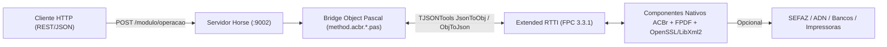

# 🌐 ACBRWebService

**Microserviço HTTP REST/JSON open-source em Object Pascal (Lazarus + Free Pascal + Horse) para integração universal com a suíte [Projeto ACBr](https://www.projetoacbr.com.br/).**

> Exponha emissões fiscais (DF-e), geração determinística de XML, validação de XSD e regras de negócio, pré-visualização de PDF (FPDF nativo sem dependências gráficas), obrigações acessórias (SPED e Sintegra), boletos bancários híbridos (CNAB 240/400 + PIX EMV), carga de balanças e impressão térmica EscPos para qualquer stack (Node.js, Python, Go, Java, C#, PHP, Rust ou automações low-code) via requisições JSON simples na porta **`9002`**.

---

## 📚 Documentação Rápida

| Documento | Conteúdo |
| :--- | :--- |
| **[API_ROUTES.md](API_ROUTES.md)** | Catálogo completo de endpoints HTTP (`GET /modelo/...` e `POST /...`), tabela de Enums RTTI e exemplos práticos de payloads JSON e `curl`. |
| **[BUILD_GUIDE.md](BUILD_GUIDE.md)** | Guia passo a passo de compilação nativa em **Windows (`win64`)** e **Linux (`x86_64`)** com Free Pascal `3.3.1` (`Extended RTTI`) + `lazbuild` e execução da suíte de testes (`TestRunner`). |

---

## ✨ Principais Capacidades

- **Documentos Fiscais Eletrônicos (DF-e):**
  - **NF-e (Modelo 55) e NFC-e (Modelo 65):** emissão síncrona/lote, consulta de protocolo e recibo, cancelamento (normal `110111` e por substituição `110112`), Carta de Correção (`CC-e`), Manifestação do Destinatário, eventos da Reforma Tributária (`IBS/CBS/IS`), inutilização, Distribuição DF-e, DANFE A4 / NFC-e 80mm em PDF (FPDF) e bobina EscPos, consulta de cadastro e envio por e-mail.
  - **CT-e (Modelo 57 — 4.00 e Simplificado):** emissão, consulta, cancelamento, eventos (CC-e, desacordo, insucesso de entrega), inutilização, Distribuição DF-e, DACTE e DACTE de Evento em PDF.
  - **MDF-e (Modelo 58):** emissão (incluindo modo síncrono SVRS), consulta, cancelamento, encerramento (com conversão resiliente ISO-8601 para `dtEnc`), consulta de não encerrados, inclusão de condutor/DF-e, Distribuição DF-e, DAMDFE / DAMDFE de Evento (com suporte a logotipo) e envio por e-mail SMTP (`POST /mdfe/email`).
  - **NFS-e (`TACBrNFSeX`):** suporte unificado ao **Padrão Nacional (`<DPS>` / ADN)** (emissão, eventos `e101101`..`e105102`, consulta de eventos por chave via `POST /nfse/consultar-eventos` e Distribuição DF-e Nacional) e a **centenas de provedores municipais** (ABRASF, ISSNet, Ginfes, Betha, SmarAPD, EL, WebISS, Tecnos, entre outros), além de DANFSe em PDF.
  - **GNRE (1.00 e 2.00):** geração determinística de XML (`POST /gnre/gnre-to-xml`), transmissão de lote e consulta de resultado (`TACBrGNRE`).
  - **EFD-Reinf, BP-e, CIOT e eSocial:** transmissão, consulta e geração de payloads via pontes dedicadas.
- **Geração Determinística de XML, Validação Offline e PDF sem Transmissão SOAP:**
  - Gere e assine XMLs localmente, valide Schemas XSD + regras de negócio SEFAZ e renderize PDFs antes (ou independentemente) de qualquer comunicação externa com webservices governamentais:
    - NF-e/NFC-e: `POST /nfe/nfe-to-xml`, `POST /nfe/nfe-from-xml`, `POST /nfe/validar-regras`, `POST /nfe/danfe`
    - CT-e: `POST /cte/cte-to-xml`, `POST /cte/cte-from-xml`, `POST /cte/validar-regras`, `POST /cte/dacte`
    - MDF-e: `POST /mdfe/mdfe-to-xml`, `POST /mdfe/evento-to-xml`, `POST /mdfe/mdfe-from-xml`, `POST /mdfe/validar-regras`, `POST /mdfe/damdfe`
    - GNRE: `POST /gnre/gnre-to-xml` (ou `POST /gnre/gerar-xml`)
    - NFS-e: `POST /nfse/nfse-to-xml`, `POST /nfse/nfse-from-xml`, `POST /nfse/danfse`
- **Obrigações Acessórias (SPED e Sintegra):**
  - **SPED Fiscal (`EFD ICMS/IPI`) e EFD Contribuições (`PIS/COFINS`):** geração completa via `TACBrSPEDFiscal` e `TACBrSPEDPisCofins` com cálculo oficial do Bloco 9, omissão configurável do Bloco P quando não aplicável, importação estruturada de TXT e consolidação de matriz/filiais.
  - **Sintegra (`POST /sintegra/gerar`):** geração magnética via `TACBrSintegra` com sanitização segura para codificação monobyte (`ASCII` / `Windows-1252` `CP1252`), prevenindo estouro de bytes UTF-8 em descrições acentuadas e garantindo **exatamente `126` colunas (`CRLF`)** em todos os registros (incluindo totalização automática dos Registros `90` e `99`).
- **Cobrança Bancária, CNAB 240/400 e PIX Híbrido (`TACBrBoleto`):**
  - Impressão de boletos em PDF (FPDF), geração de arquivos de **Remessa CNAB 240 e 400** (com sanitização de acentos, inferência automática de `TipoCobranca` pelo código FEBRABAN do banco e retorno da linha digitável/código de barras/nosso número de cada título), **Leitura de Retorno CNAB 240/400** (com detecção automática de layout `240`/`400` e banco pelo header do arquivo), integração com APIs bancárias e geração de payload **PIX EMV (`BRCode`)** para boletos híbridos (`POST /boleto/pix-emv`).
- **Automação Comercial e Utilitários (`Hardware & Diversos`):**
  - **Carga de Balanças (`TACBrCargaBal`):** geração de arquivos de carga (`POST /diversos/balanca/carga`) para **Toledo (`MGV5`, `MGV6`, `MGV7`)**, **Filizola**, **Urano**, **Ramuza** e **Triunfo**, além de decodificação de códigos EAN-13 de balança (`TACBrInStore` em `POST /diversos/balanca/instore`).
  - **Impressão Térmica EscPos (`TACBrPosPrinter`):** envio direto para portas seriais/USB/TCP/RAW ou geração de **spool binário em memória (`Base64`)** (`GerarSpool: true` ou `Porta: "BUFFER"`) para transporte ao terminal de caixa (`POST /escpos/escpos` e `GET /escpos/portas`).
  - **Utilitários Fiscais:** certificados digitais A1 (`POST /certificados/upload`, `POST /certificados/ler-dados`), validação de CPF/CNPJ/IE/GTIN/CEP (`POST /diversos/validador`), cheque CMC7 (`POST /diversos/cmc7`), assinatura EAD/MD5 (`POST /diversos/ead`), dígito verificador (`POST /diversos/calc-digito`), valor por extenso (`POST /diversos/extenso`), tabela IBPTax (`POST /diversos/ibpt/ler-tabela`) e envio SMTP (`POST /diversos/mail`).

---

## 🏗️ Arquitetura: Horse + Extended RTTI (`TJSONTools`)

Diferente de wrappers manuais que exigem manutenção de centenas de DTOs intermediários a cada Nota Técnica da SEFAZ, o **ACBRWebService** combina o microframework HTTP **[Horse](https://github.com/HashLoad/horse)** (escutando por padrão na porta **`9002`**) com o **Extended RTTI (`TRttiContext`)** do **Free Pascal `3.3.1` (`-dENABLE_DELPHI_RTTI`)**.



### 1. Descoberta Dinâmica de Payloads (`GET /modelo/<modulo>/<operacao>`)
Toda rota de operação possui um endpoint espelho `GET /modelo/<modulo>/<operacao>` que instancia o componente real do ACBr em memória, executa `TJSONTools.ObjToJson` via RTTI e devolve o esqueleto JSON exato aceito pela versão compilada:

```bash
# Inspecionar a estrutura completa de configuração da NF-e
curl -s http://localhost:9002/modelo/nfe/config

# Inspecionar o esqueleto RTTI completo de emissão de NF-e, CT-e, MDF-e ou GNRE
curl -s http://localhost:9002/modelo/nfe/nfe
curl -s http://localhost:9002/modelo/cte/cte
curl -s http://localhost:9002/modelo/mdfe/mdfe
curl -s http://localhost:9002/modelo/gnre/guia
```

### 2. Resolução Inteligente de `PathSchemas` Relativa ao Binário
Em todas as pontes DF-e (`NFe`, `CTe`, `MDFe`, `NFSe` e `GNRe`), os caminhos internos são resolvidos sempre de forma relativa ao diretório do executável (`ExtractFilePath(ParamStr(0))`), sem depender do diretório corrente do shell:
- Se `config.Arquivos.PathSchemas` for omitido (`""`) **ou** apontar apenas para o diretório raiz `Schemas/` (ex.: `<bin>/Schemas`), o servidor resolve automaticamente a subpasta específica do modelo:
  - `TACBrNFe` $\rightarrow$ `<bin>/Schemas/NFe/`
  - `TACBrCTe` $\rightarrow$ `<bin>/Schemas/CTe/`
  - `TACBrMDFe` $\rightarrow$ `<bin>/Schemas/MDFe/`
  - `TACBrNFSeX` $\rightarrow$ `<bin>/Schemas/NFSe/` (aplicado antes de `LerParamsMunicipio` para correta resolução do provedor)
  - `TACBrGNRE` $\rightarrow$ `<bin>/Schemas/GNRe/`

### 3. Estabilidade Criptográfica Cross-Platform (Win64 & Linux x86_64)
Todas as pontes DF-e padronizam automaticamente `SSLLib = libOpenSSL`, `SSLCryptLib = cryOpenSSL`, `SSLHttpLib = httpOpenSSL` e `SSLXmlSignLib = xsLibXml2`, suportando tanto caminho de certificado no host (`Certificados.ArquivoPFX`) quanto carregamento direto em memória via Base64 (`Certificados.DadosPFXBase64` ou `Certificados.DadosPFX`), sem gravar chaves privadas temporárias em disco.

---

## 🚀 Exemplos Rápidos de Uso (`curl`)

> 💡 Todos os exemplos abaixo utilizam exclusivamente dados sintéticos universais (`12.345.678/0001-95`, `00.000.000/0000-00`, `EMPRESA EXEMPLO LTDA`). Veja dezenas de exemplos adicionais em **[API_ROUTES.md](API_ROUTES.md)**.

### 1. Gerar XML Determinístico de GNRE 2.00 (Sem Transmissão SOAP)
```bash
curl -X POST http://localhost:9002/gnre/gnre-to-xml \
  -H "Content-Type: application/json" \
  -d '{
    "config": {
      "Geral": { "VersaoDF": "ve200" },
      "WebServices": { "Ambiente": "taHomologacao", "UF": "SP" }
    },
    "VersaoDF": "ve200",
    "c01_UfFavorecida": "SP",
    "c02_receita": 100099,
    "c03_idContribuinteEmitente": { "CNPJ": "12345678000195" },
    "c28_tipoDocOrigem": 10,
    "c04_docOrigem": "1001",
    "c06_valorPrincipal": 150.00,
    "c10_valorTotal": 150.00,
    "c14_dataVencimento": "2026-12-31",
    "c16_razaoSocialEmitente": "EMPRESA EXEMPLO LTDA",
    "c18_enderecoEmitente": "AVENIDA EXEMPLO, 1000",
    "c19_municipioEmitente": "50308",
    "c20_ufEnderecoEmitente": "SP",
    "c21_cepEmitente": "01001000",
    "camposExtras": [
      { "codigo": 86, "tipo": "T", "valor": "35260112345678000195550010000010011000010015" }
    ]
  }'
```

### 2. Gerar Arquivo Sintegra (`126` Colunas `CP1252` / `ASCII`)
```bash
curl -X POST http://localhost:9002/sintegra/gerar \
  -H "Content-Type: application/json" \
  -d '{
    "RetirarAcentos": true,
    "Registro10": {
      "CNPJ": "12345678000195",
      "Inscricao": "110042490114",
      "RazaoSocial": "EMPRESA EXEMPLO COMÉRCIO E INDÚSTRIA LTDA",
      "Cidade": "SÃO PAULO",
      "Estado": "SP",
      "Telefone": "1130000000",
      "DataInicial": "2026-01-01",
      "DataFinal": "2026-01-31",
      "CodigoConvenio": "3",
      "NaturezaInformacoes": "3",
      "FinalidadeArquivo": "1"
    },
    "Registro11": {
      "Endereco": "AVENIDA EXEMPLO",
      "Numero": "1000",
      "Bairro": "CENTRO",
      "Cep": "01001000",
      "Responsavel": "CONTADOR EXEMPLO",
      "Telefone": "1130000000"
    }
  }'
```

### 3. Gerar Spool EscPos em Memória (`Base64`) sem Impressora Física Conectada
```bash
curl -X POST http://localhost:9002/escpos/escpos \
  -H "Content-Type: application/json" \
  -d '{
    "Modelo": "ppEscPosEpson",
    "PaginaDeCodigo": "pc850",
    "ColunasFonteNormal": 48,
    "Porta": "BUFFER",
    "GerarSpool": true,
    "CortaPapel": true,
    "Linhas": [
      "</zera><ce><n>EMPRESA EXEMPLO LTDA</n></ce>",
      "<ce>CNPJ: 12.345.678/0001-95</ce>",
      "</linha_simples>",
      "<ae>ITEM 001 - PRODUTO EXEMPLO          R$ 25,00</ae>",
      "</linha_simples>",
      "<ad><e>TOTAL: R$ 25,00</e></ad>",
      "</corte_parcial>"
    ]
  }'
```

### 4. Gerar Arquivos de Carga para Balança (`Toledo MGV6` / `Filizola`)
```bash
curl -X POST http://localhost:9002/diversos/balanca/carga \
  -H "Content-Type: application/json" \
  -d '{
    "Modelo": "modToledoMGV6",
    "RetirarAcentos": true,
    "Produtos": [
      {
        "Codigo": 101,
        "Descricao": "PAO FRANCES KG",
        "ValorVenda": 16.90,
        "Validade": 2,
        "Tipo": "tpvPeso"
      }
    ]
  }'
```

---

## 🛠️ Compilação Rápida (Windows & Linux)

### Requisitos Essenciais
| Componente | Versão Obrigatória | Detalhe |
| :--- | :--- | :--- |
| **Free Pascal (FPC)** | **`3.3.1` (`trunk`)** | Compilado com **`-dENABLE_DELPHI_RTTI`** (`EnableRTTI=1` no `fpcupdeluxe`). |
| **Lazarus (`lazbuild`)** | **`4.x` (`fixes_4` / `4.99`)** | Com `{$EXTENDEDRTTI ON}` na linha 3 de `acbr/Fontes/ACBrComum/ACBr.inc`. |

### Windows (`win64` / `x86_64`)
```powershell
cd C:\BuildWebService\src
& "C:\fpcupdeluxe\lazarus\lazbuild.exe" --max-process-count=1 --os=win64 --cpu=x86_64 ACBRWebService.lpi
# Binário gerado em: bin\ACBRWebService-x86_64-win64.exe
```

### Linux (`linux` / `x86_64` — Nativo sem Docker)
```bash
cd ~/BuildWebService/src
chmod +x setup-vm.sh download.sh build.sh
sudo ./setup-vm.sh && source ~/.profile
./download.sh
./build.sh
# Binário nativo gerado em: bin/ACBRWebService-x86_64-linux
```

### Executar Testes Automatizados (`FPCUnit`)
```powershell
# Compilar o TestRunner
& "C:\fpcupdeluxe\lazarus\lazbuild.exe" --max-process-count=1 --os=win64 --cpu=x86_64 tests\unit\TestRunner.lpi

# Com o ACBRWebService em execução na porta 9002 e as DLLs de bin\ no PATH:
$env:PATH = "$PWD\bin;$env:PATH"
.\tests\unit\TestRunner.exe --all --format=plain
```

> 📖 Consulte **[BUILD_GUIDE.md](BUILD_GUIDE.md)** para a lista completa de pacotes `.lpk`, bibliotecas dinâmicas (`OpenSSL` e `LibXml2`) e instruções de build em container Docker ou GitHub Actions.

---

## 🔒 Segurança e Boas Práticas em Produção

1. **Isolamento de Rede:** Por design, o `ACBRWebService` opera como um microserviço interno (sidecar ou rede privada de containers/servidores) sem camada própria de autenticação de usuários. **Nunca exponha a porta `9002` diretamente na internet pública** — restrinja o bind/firewall à rede interna do backend consumidor ou utilize proxy reverso autenticado (mTLS / API Gateway).
2. **Proteção de Certificados e Artefatos Sensíveis:** Nunca versione arquivos `.pfx`, `.p12`, `.pem`, `.key`, arquivos `.ini` de produção, PDFs ou XMLs de documentos reais. O `.gitignore` do repositório bloqueia automaticamente `bin/`, `**/certificados/**`, `**/pdf/**`, `**/tmp/**`, `**/logs/**`, `**/spool/**` e chaves criptográficas.

---

## 📝 Licença e Aviso Legal

Este projeto é distribuído como software livre sob licença compatível com o ecossistema [Projeto ACBr](https://www.projetoacbr.com.br/) (LGPL). O nome "ACBr" e os componentes subjacentes pertencem aos respectivos mantenedores do [Projeto ACBr](https://www.projetoacbr.com.br/); este repositório é uma ponte HTTP independente mantida pela comunidade.
