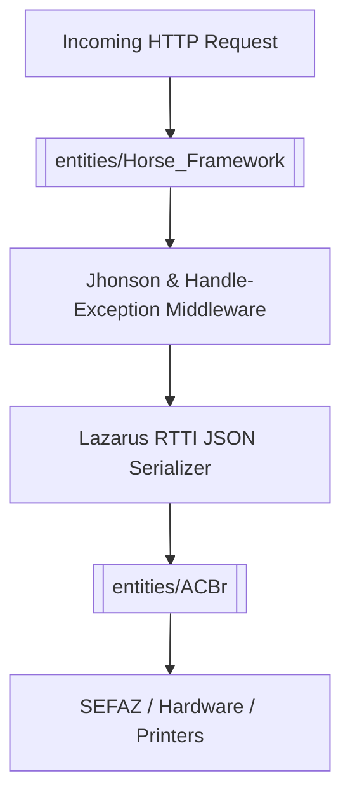

# ACBRWebService Architecture

The **ACBRWebService** is designed as an unauthenticated REST microservice bridge wrapping the [[entities/ACBr]] Pascal component suite for fiscal document processing and hardware automation.

## Component Architecture

1. **HTTP Layer**: Uses [[entities/Horse_Framework]] for route registration and endpoint management.
2. **Serialization Layer**: Leverages Lazarus FPC RTTI (`fpjson` / `jsonrtti`) to reflect incoming JSON body directly to Pascal object instances (`TObject`).
3. **Business & Fiscal Layer**: Delegates document validation, XML parsing, NFe/CTe generation, and ESCPOS printing to [[entities/ACBr]].
4. **Target Platform**: Exclusively targets [[entities/Lazarus_FPC]] compiler environments.
