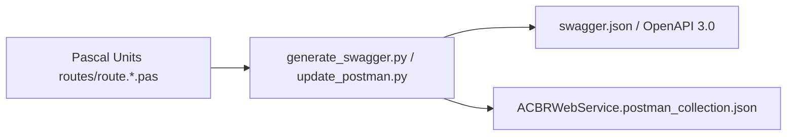

# API Documentation & Postman Generators

The **API Documentation & Postman Generators** dynamically parse Horse route definitions and JSON models to generate updated OpenAPI 3.0 specs (`swagger.json`) and Postman collections.

## Related Pages
- [[ACBRWebService_Architecture]]
- [[tools-and-utilities]]
