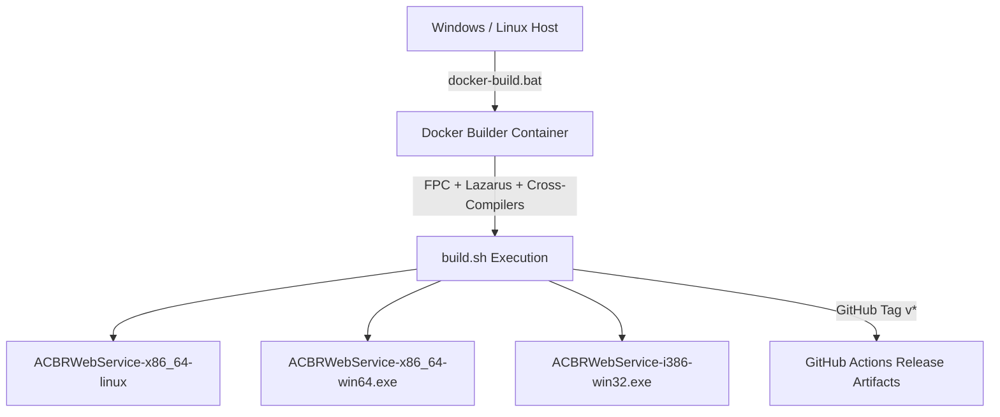

# Container & Cross-Platform Build Pipeline

The **Container Build Pipeline** allows building ACBRWebService multi-architecture binaries without installing Free Pascal or Lazarus on the local host machine.

## Binary Outputs

- `ACBRWebService-x86_64-linux`
- `ACBRWebService-x86_64-win64.exe`
- `ACBRWebService-i386-win32.exe`

## Related Pages
- [[ACBRWebService_Architecture]]
- [[Lazarus_FPC]]
- [[docker-build-pipeline]]
