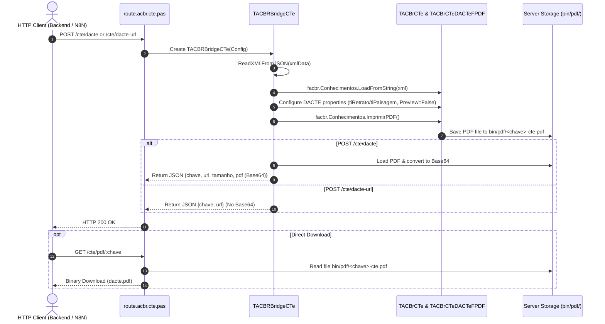

# DACTE Auxiliary Document Subsystem

The **DACTE (Documento Auxiliar do Conhecimento de Transporte Eletrônico)** subsystem in ACBRWebService renders official PDF transport documents from CT-e XML payloads using the FreePascal / ACBr report generation engine (`TACBrCTeDACTeFPDF`).

---

## Architectural Workflow



---

## Core Components & Configuration

1. **`TACBrCTeDACTeFPDF` Component**:
   - Attached dynamically via `facbr.DACTE := fdacte`.
   - Non-interactive settings enforced for headless execution:
     - `fdacte.MostraPreview := False;`
     - `fdacte.MostraStatus := False;`
     - `fdacte.MostraSetup := False;`

2. **Automatic Layout Orientation**:
   - Evaluates the CT-e layout orientation from `Ide.tpImp`:
     ```pascal
     if facbr.Conhecimentos.Items[0].CTe.Ide.tpImp <> tiPaisagem then
       fdacte.TipoDACTE := tiRetrato
     else
       fdacte.TipoDACTE := tiPaisagem;
     ```

3. **PDF Storage Management**:
   - PDFs are stored in the server's `./pdf/` directory (`ExtractFilePath(ParamStr(0)) + 'pdf'`).
   - Naming convention: `<chave>-cte.pdf` or `CTe<chave>-cte.pdf`.

---

## Route & Performance Profiles

| Route | Payload Return | Best Used For |
| :--- | :--- | :--- |
| `POST /cte/dacte` | Full Base64 PDF + Download URL | Synchronous rendering where client requires immediate embedded PDF bytes. |
| `POST /cte/dacte-url` | Download URL + Key only | Microservices, webhooks, or automation flows (e.g. N8N) to minimize bandwidth. |
| `GET /cte/pdf/:chave` | Direct binary file stream | Direct browser display or downloading PDF attachments. |

---

## Related Pages
- [[CTe_REST_Endpoints]]
- [[ACBRWebService_Architecture]]
- [[JSON_RTTI_Serialization]]
