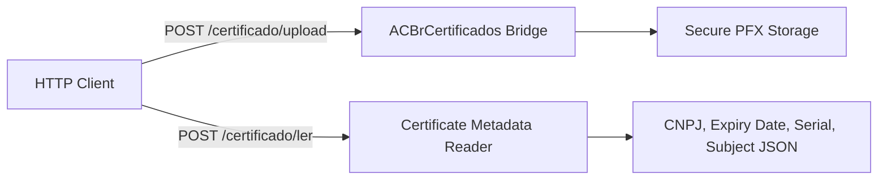

# Digital Certificate Management

The **Digital Certificate Management** module allows uploading, storing, and reading ICP-Brasil A1 PFX digital certificates over HTTP endpoints.

## Route Specifications

| Method | Endpoint Path | Description |
|--------|--------------|-------------|
| `GET` | `/certificado/modelo/upload` | JSON template for uploading A1 PFX certificate |
| `POST` | `/certificado/upload` | Uploads PFX file payload and password |
| `POST` | `/certificado/ler` | Parses certificate details without saving |

## Related Pages
- [[ACBRWebService_Architecture]]
- [[route-acbr-certificados]]
- [[NFe_REST_Endpoints]]
- [[ACBr]]
