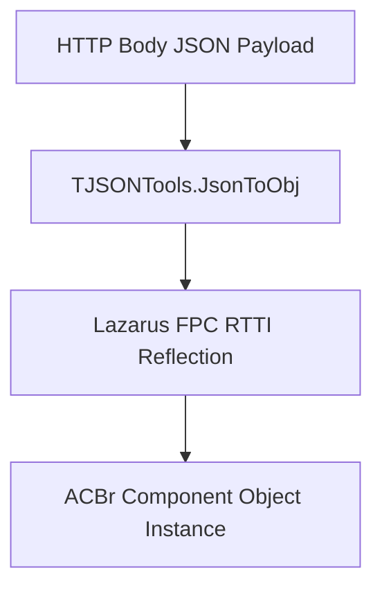

# Lazarus RTTI & JSON Serialization Engine

The **JSON RTTI Serialization Engine** (`TJSONTools` in `tools/jsonconvert.pas`) is the core mechanism enabling ACBRWebService to transform HTTP JSON request payloads directly into Pascal `TObject` properties.

## Key Mechanisms

1. **Object Instantiation (`NotasFiscais.New`)**: For collection properties (such as `facbr.NotasFiscais`), items must be explicitly allocated via `.New` before RTTI deserialization to prevent empty collection errors.
2. **In-Memory Base64 PFX Certificates**: Accepts `DadosPFXBase64` directly into `facbr.Configuracoes.Certificados.DadosPFX` without writing temporary PFX files to disk.
3. **Dual-Directional XML ⇄ JSON**: Converts XML Base64 strings to JSON via `nfse-from-xml` and serializes JSON back to XML via `nfse-to-xml`.

## Related Pages
- [[ACBRWebService_Architecture]]
- [[Lazarus_FPC]]
- [[NFSe_REST_Endpoints]]
- [[tools-and-utilities]]
