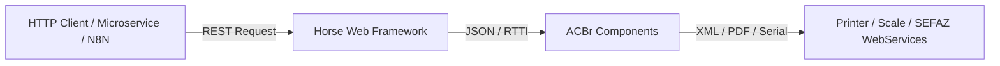

# Summary: ACBRWebService Overview

The **ACBRWebService** project is a REST API built with Free Pascal Compiler (FPC) and Lazarus that exposes the functionality of the **ACBr** library via HTTP. It enables any microservice architecture or automation platform (such as N8N) to validate tax documents (CPF/CNPJ), process NFe/CTe/NFSe XMLs, generate DANFE PDFs in Base64, communicate directly with POS receipt printers using ESCPOS, and query connected electronic scales.

## Key Highlights

- **Framework & Compiler**: Built exclusively for **Lazarus / FPC** (does not compile on Delphi due to Lazarus-specific RTTI engine used for JSON-to-Object serialization).
- **Core HTTP Stack**: Uses **Horse** framework combined with `jhonson` for JSON middleware and `handle-exception` for error handling.
- **Cross-Platform Compilation**: Supports build output for Linux x86_64, Windows x86_64, and Windows i386 via Docker containerized builds (`docker-build.bat`) or automated GitHub Actions CI/CD workflows.
- **Key Integrations**: ACBr, FortesReport-CE4, PowerPDF, and ESCPOS hardware controllers.
