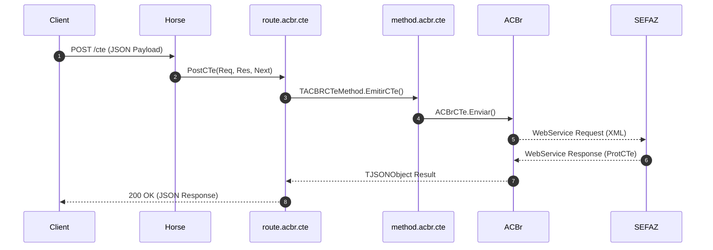

# Summary: Route ACBr CTe

The `route.acbr.cte` unit registers Horse REST API endpoints for freight and cargo transportation invoices (CTe - Modelo 57).

## Key Highlights

- **Freight Invoice Lifecycle**: Handles CTe emission, SEFAZ status check, and cancellation.
- **DACTE Generation**: Converts CTe XML into Base64 PDF formatted DACTE receipt via FortesReport/PowerPDF.
