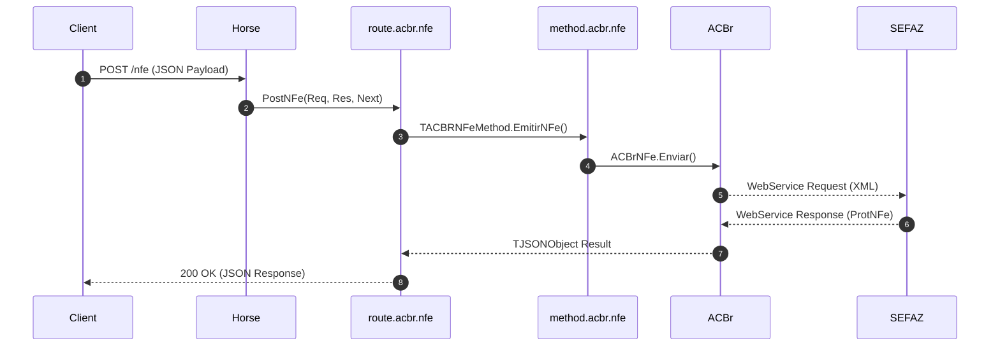

# Summary: Route ACBr NFe

The `route.acbr.nfe` unit registers all Horse HTTP routes for managing NFe (Nota Fiscal Eletrônica). It bridges JSON payloads from client applications to the underlying [[entities/ACBr]] NFe component via [[entities/Horse_Framework]] procedures.

## Key Capabilities

- **Emission & Status**: Query SEFAZ availability (`PostStatusServicoNFe`) and submit NFe batches (`PostNFe`).
- **Printing / DANFE**: Convert XML to PDF DANFE encoded in Base64 (`PostDANFe`).
- **Events & Distribution**: Handle NFe events (`PostEventos`) and query distribution NSUs (`PostDistribuicao`).
- **Number Management**: Handle number cancellation (`PostCancelamentoNFe`) and inutilization (`PostInutilizacaoNFe`).
