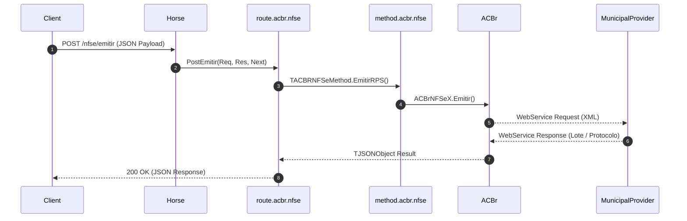

# Summary: Route ACBr NFSe

The `route.acbr.nfse` unit registers Horse REST API endpoints for municipal service invoices (NFSe / RPS).

## Key Highlights

- **Multi-Provider Support**: Interfaces with over 100 Brazilian municipal providers via ACBrNFSeX.
- **RPS Batching & Query**: Supports asynchronous RPS batch submission and subsequent status/lote queries.
- **DANFSe PDF**: Encodes municipal service invoice receipts into Base64 PDF.
